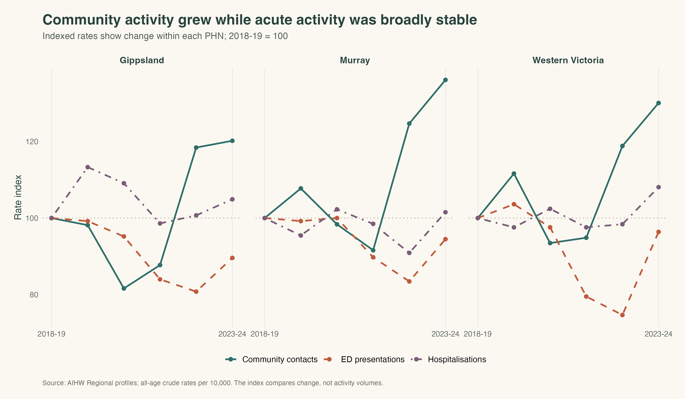
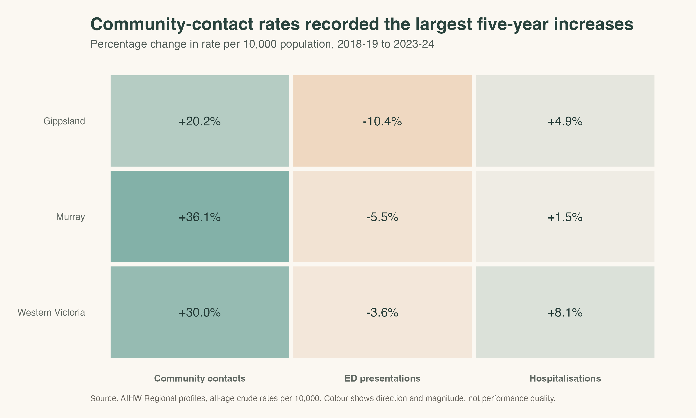
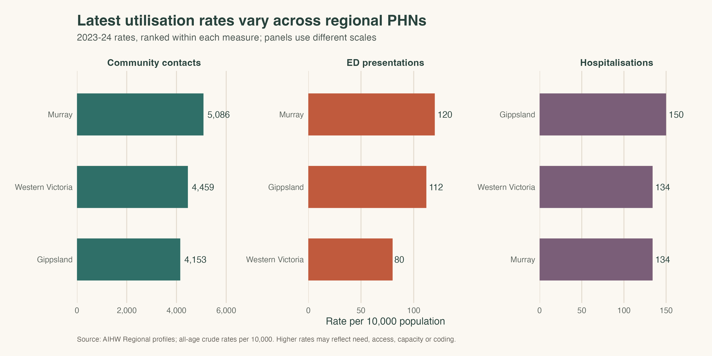
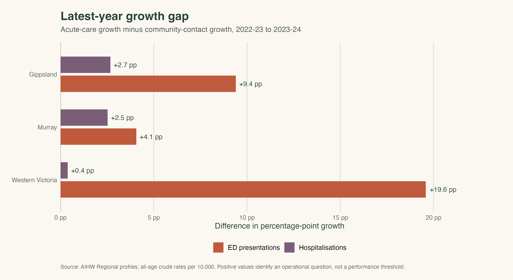

```{r}
#| include: false
source("R/briefing_helpers.R")
briefing <- prepare_briefing()
metrics <- briefing$metrics
```

<nav class="brief-nav" aria-label="Briefing navigation">
  <span>Health service analytics · Portfolio case study</span>
  <span class="brief-nav-links">
    <a href="#summary">Summary</a>
    <a href="#trends">Trends</a>
    <a href="#profile">Regional profile</a>
    <a href="#review">Latest-year change</a>
    <a href="#methods">Methods</a>
    <a href="https://github.com/sagrikachugh/mental-health-data-project">Source code</a>
  </span>
</nav>

::: {.brief-header}
::: {}
<p class="brief-eyebrow">Independent analytical briefing</p>

# Victorian regional mental-health service utilisation

<p class="brief-deck">Community contacts, ED presentations and hospitalisations across Gippsland, Murray and Western Victoria.</p>

<div class="business-question"><strong>Question</strong><br>How has mental-health service utilisation changed across regional Victorian PHNs, and which patterns warrant a closer look?</div>
:::

::: {.brief-meta}
<dl>
  <div><dt>Reporting period</dt><dd>2018–19 to 2023–24</dd></div>
  <div><dt>Geography</dt><dd>Three regional Victorian PHNs</dd></div>
  <div><dt>Measures</dt><dd>All-age crude rates per 10,000</dd></div>
  <div><dt>Source</dt><dd>Australian Institute of Health and Welfare</dd></div>
  <div><dt>Prepared by</dt><dd>Sagrika Chugh</dd></div>
</dl>
:::
:::

::: {.metric-strip aria-label="Headline indicators"}
::: {.metric}
<span class="metric-value">`r fmt_pct(metrics$largest_community$five_year_change_pct, signed = TRUE)`</span>
<span class="metric-label">Largest five-year community growth</span>
<span class="metric-context">`r metrics$largest_community$region`, 2018–19 to 2023–24</span>
:::
::: {.metric}
<span class="metric-value">`r fmt_rate(metrics$largest_community$latest_rate)`</span>
<span class="metric-label">Community contacts per 10,000</span>
<span class="metric-context">`r metrics$largest_community$region`, 2023–24</span>
:::
::: {.metric}
<span class="metric-value">`r fmt_pct(metrics$largest_latest_ed$ed_change_pct)`</span>
<span class="metric-label">Largest latest-year ED increase</span>
<span class="metric-context">`r metrics$largest_latest_ed$region`, 2022–23 to 2023–24</span>
:::
::: {.metric}
<span class="metric-value">`r fmt_rate(metrics$community_range)`</span>
<span class="metric-label">Community-contact regional range</span>
<span class="metric-context">Rate difference, 2023–24</span>
:::
:::

## What the data shows {#summary}

::: {.executive-grid}
::: {}
<ol class="key-findings">
  <li><strong>Community-contact rates rose in all three PHNs.</strong> `r community_change_summary(briefing)`</li>
  <li><strong>The five-year acute-care pattern was steadier.</strong> ED presentation rates were lower in 2023–24 than in 2018–19 in every PHN; hospitalisation rates increased by between `r fmt_pct(metrics$hospital_min_change)` and `r fmt_pct(metrics$hospital_max_change)`.</li>
  <li><strong>But the final year broke from that longer pattern.</strong> ED and hospitalisation rates grew faster than community contacts in every PHN between 2022–23 and 2023–24.</li>
  <li><strong>The regions do not look alike.</strong> `r latest_profile_summary(briefing)`</li>
</ol>
:::

::: {.management-note}
### What I would check next

The final-year rise in acute activity is worth checking because it runs against the longer pattern. It may reflect a real shift, a reporting change or a mixture of both; these data cannot tell us which.

**First checks**

- confirm whether the increase continues in newer data;
- review Western Victoria's ED change;
- review Gippsland's hospitalisation profile; and
- check for changes in coding, coverage or service configuration.
:::
:::

## Long-term trend {#trends}

<div class="figure-question">Question 1</div>

### How has the service mix changed?

::: {.figure-panel}
::: {.figure-visual}
{fig-alt="Three small-multiple line charts indexed to 2018–19. Community-contact rates rise in Gippsland, Murray and Western Victoria, while emergency department and hospitalisation rates remain comparatively stable over five years."}
:::

::: {.figure-reading}
### What stands out

Community-contact rates increased more than ED presentations or hospitalisations over the full period in every PHN.

Indexing allows the direction and scale of change to be compared across indicators. It does not compare activity volumes.

<p class="interpretation"><strong>Next check:</strong> See whether community activity continues to rise and whether the acute-care pattern stays stable in newer reporting periods.</p>
:::
:::

<div class="figure-question">Question 2</div>

### Which indicators changed most over five years?

::: {.figure-panel}
::: {.figure-visual}
{fig-alt="Horizontal bars compare five-year percentage changes. Community contacts record the largest increases. Emergency department presentations decline across all three PHNs, while hospitalisations increase modestly."}
:::

::: {.figure-reading}
### What stands out

- `r metrics$largest_community$region` recorded the largest community-contact increase: **`r fmt_pct(metrics$largest_community$five_year_change_pct)`**.
- `r metrics$largest_ed_decrease$region` recorded the largest ED change: a **`r fmt_pct(abs(metrics$largest_ed_decrease$five_year_change_pct))` decrease**.
- `r metrics$largest_hospital_increase$region` recorded the largest hospitalisation increase: **`r fmt_pct(metrics$largest_hospital_increase$five_year_change_pct)`**.

<p class="interpretation"><strong>Interpretation:</strong> Percentage change should be read alongside the underlying rate, particularly for the smaller acute-care indicators.</p>
:::
:::

## Latest regional profile {#profile}

<div class="figure-question">Question 3</div>

### Which PHNs recorded the highest latest rates?

::: {.figure-panel}
::: {.figure-visual}
{fig-alt="Three ranked horizontal bar charts show 2023–24 rates. Murray has the highest community-contact and ED rates. Gippsland has the highest hospitalisation rate."}
:::

::: {.figure-reading}
### What stands out

`r latest_profile_rates(briefing)`

<p class="interpretation"><strong>Interpretation:</strong> A higher rate does not by itself indicate better or poorer performance. Consider population need, access, capacity, service models and data coverage.</p>
:::
:::

::: {.data-detail}
### Published 2023–24 rates

```{r}
briefing |> latest_rate_table() |>
  knitr::kable(format = "html", format.args = list(big.mark = ","))
```
:::

## Where the latest year changed {#review}

<div class="figure-question">Question 4</div>

### Where did acute activity grow faster than community contacts?

::: {.figure-panel}
::: {.figure-visual}
{fig-alt="Paired comparisons show emergency department and hospitalisation growth exceeded community-contact growth in all three PHNs between 2022–23 and 2023–24. The largest gap is emergency department growth in Western Victoria."}
:::

::: {.figure-reading}
### What stands out

Both acute indicators grew faster than community contacts in every PHN in the latest year.

`r metrics$largest_latest_ed$region` recorded the largest ED growth gap: **`r fmt_pct(metrics$largest_latest_ed$ed_change_pct)` ED growth** compared with **`r fmt_pct(metrics$largest_latest_ed$community_change_pct)` community-contact growth**.

<p class="interpretation"><strong>Read with care:</strong> These differences point to questions, not performance thresholds. They do not show that changes in community care caused the rise in acute activity.</p>
:::
:::

::: {.review-grid}
::: {.review-table}
### Latest-year change

```{r}
briefing |> operational_review_table() |>
  knitr::kable(format = "html", align = c("l", "r", "r", "r", "r"))
```

<div class="priority-note"><strong>Worth noting:</strong> `r metrics$largest_latest_ed$region`'s ED rate remained the lowest of the three PHNs, but its latest annual increase was the largest. The level and the change tell different parts of the story.</div>
:::

::: {}
### Questions raised by the data

1. Did demand, case complexity or clinical acuity change in 2023–24?
2. Were there changes in access, waiting times, capacity, opening hours or referral pathways?
3. Did coding, collection coverage or reporting practices change?
4. Are the trends concentrated in particular age groups, local areas, providers or diagnostic groups?
5. Do patient-flow data show repeated ED use, readmissions or gaps following discharge?
:::
:::

## Methods and limitations {#methods}

::: {.method-grid}
::: {}
### Method

The reproducible R workflow:

1. reads the original AIHW dashboard exports;
2. selects published all-age PHN rates;
3. validates the complete 3-region × 3-indicator × 6-year panel;
4. calculates annual and five-year percentage changes;
5. indexes series to 2018–19; and
6. compares regional ranges and latest-year acute/community growth.

No modelling or significance testing is used. This is a transparent descriptive comparison intended to support reporting and identify questions for follow-up.

<div class="reproduce"><strong>Reproduce locally</strong><br><code>Rscript analysis.R</code><br><code>quarto render</code></div>
:::

::: {}
### Data quality and limitations

- Rates are crude rather than age-standardised.
- Community contacts are encounters, not unique patients.
- Indicators come from different collections and cannot be combined into a single measure of demand.
- Utilisation reflects need, access, capacity, pathways, service models, coding and data coverage.
- COVID-19 and population change complicate comparison across the period.
- Percentage changes in smaller acute-care rates are sensitive to rounding.
- The analysis covers three regional PHNs and is not a statewide assessment.
:::
:::

<div class="brief-footer">
<p><strong>Source:</strong> <a href="https://www.aihw.gov.au/mental-health/monitoring/regional-profiles">AIHW Regional profiles of mental health service activity</a>, dashboard exports retrieved 27 September 2026.</p>
<p><strong>Status:</strong> Independent portfolio case study using public data. This is not an official Victorian Government publication. Analysis and interpretation by Sagrika Chugh.</p>
</div>
